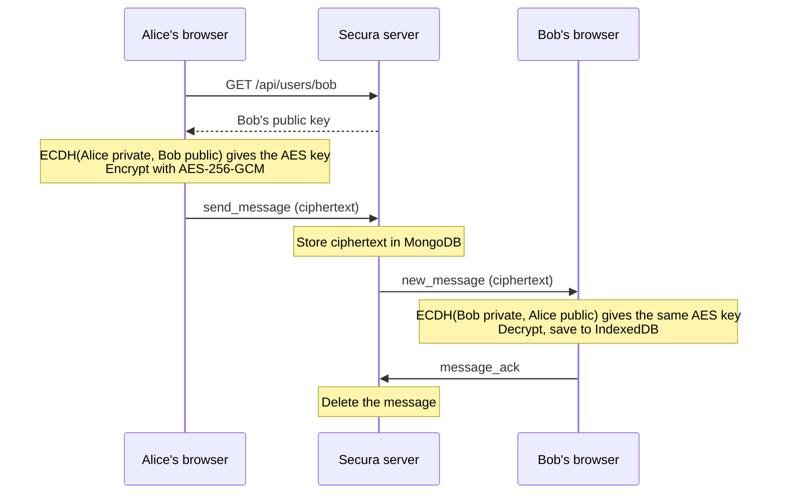
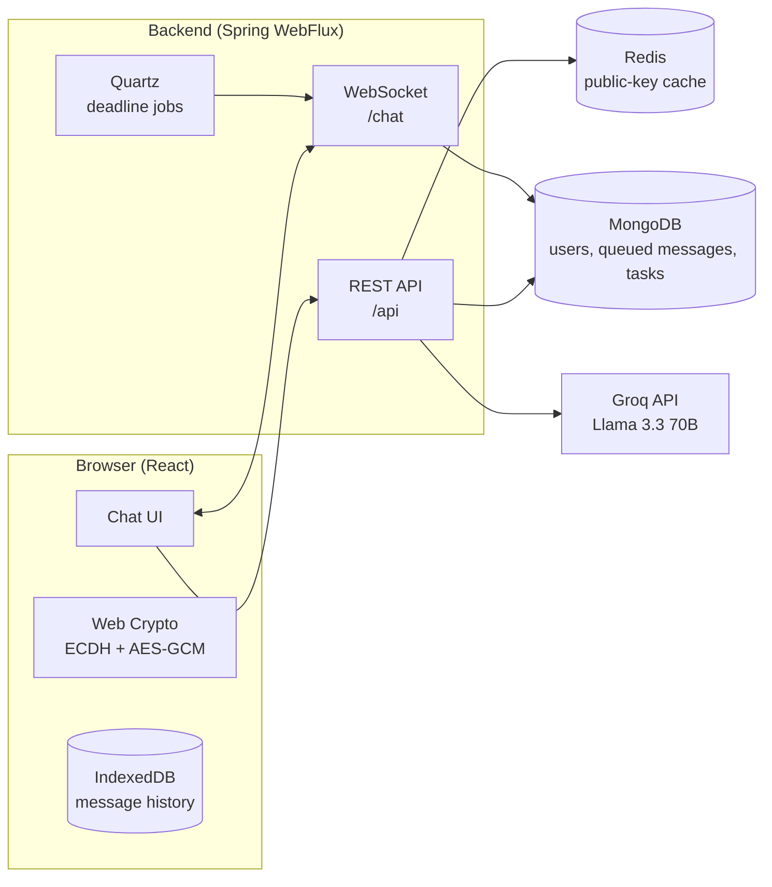

# Secura

End-to-end encrypted one-to-one chat with AI built in. You can ask an LLM questions inside a conversation, summarize a chat, and turn messages into tasks that send deadline reminders.


Messages are encrypted in the browser before they are sent. The server only relays ciphertext it cannot read, and it deletes each message as soon as the recipient's browser confirms delivery.

## Features

- **End-to-end encryption.** Each browser gets its own ECDH key pair, and every conversation uses an AES-256-GCM key that only the two participants can derive.
- **Offline delivery.** Messages sent to an offline user are queued (still encrypted) and pushed to them when they reconnect.
- **Presence.** The server tracks who is online and broadcasts status changes over WebSocket.
- **Key-change alerts.** If a contact's public key changes, for example after they log in on a new device, the app tells you.
- **`@AI` in chat.** Type `@AI` followed by a question, and the LLM's answer is posted into the conversation, encrypted like any other message, for both people to see.
- **Chat summaries.** One click summarizes the current conversation.
- **Tasks from messages.** Select messages and click **Extract Task**. The LLM pulls out a title, assignee and deadline, and resolves relative times like "tomorrow 5pm" in the user's own timezone.
- **Deadline reminders.** When a task's deadline arrives, the backend pushes a notification to both the assignee and the person who assigned it, and the browser shows it as a desktop notification.

## How the encryption works

1. The first time you register or log in, your browser uses the Web Crypto API to generate an ECDH key pair on the P-256 curve. The private key stays in your browser. Only the public key is sent to the server.
2. To message Bob, Alice's browser fetches Bob's public key (served from a Redis cache, with MongoDB as the fallback). It then combines that key with Alice's private key using ECDH to derive a 256-bit AES-GCM key. Bob derives the same key from his private key and Alice's public key, so the shared key itself never crosses the network.
3. Each message is encrypted with AES-256-GCM using a fresh random 96-bit IV. The IV is prepended to the ciphertext and the result is sent base64-encoded.
4. The server stores the ciphertext in MongoDB and pushes it to Bob over WebSocket, either right away or when he next connects. Once Bob's browser acknowledges the message, the server deletes it.
5. Bob's browser decrypts the message and keeps the plaintext history locally in IndexedDB.



> [!NOTE]
> **The AI features work on plaintext.** `@AI` sends your question, **Summarize Chat** sends the decrypted conversation, and **Extract Task** sends the selected messages to the Secura backend, which forwards them to the Groq API. Messages you don't use with these features never leave the two browsers unencrypted.

## Architecture



## Tech stack

| Layer | Technologies |
|---|---|
| Frontend | React 19, Vite 7, Web Crypto API, Dexie (IndexedDB) |
| Backend | Java 21, Spring Boot 3.5, Spring WebFlux (reactive REST and WebSocket), Quartz Scheduler, BCrypt |
| Data | MongoDB (reactive driver), Redis (reactive) |
| AI | Groq API running `llama-3.3-70b-versatile` |
| Ops | Docker, Nginx, Spring Boot Actuator |

## Project structure

```
secura/
├── backend/                     Spring Boot API and WebSocket server
│   └── src/main/java/com/secura/
│       ├── config/              CORS, WebSocket, Quartz, MongoDB, WebClient
│       ├── controller/          REST endpoints: accounts and AI features
│       ├── service/             WebSocket handler, public-key cache, task scheduling and notifications
│       ├── job/                 Quartz job that fires at a task's deadline
│       ├── entity/              User, Message and Task documents
│       └── repository/          Reactive MongoDB repositories
└── frontend/                    React client
    └── src/
        ├── utils/crypto.js      Key generation, key derivation, encrypt/decrypt
        ├── hooks/               useAuth, useChat, useWebSocket
        ├── services/            REST and WebSocket clients, IndexedDB message store
        └── components/          UI components
```

## Getting started

### Prerequisites

- JDK 21
- Node.js 20.19+ or 22.12+ (required by Vite 7)
- MongoDB and Redis, either local or hosted (for example MongoDB Atlas and Redis Cloud). To run both locally with Docker:

  ```bash
  docker run -d --name secura-mongo -p 27017:27017 mongo:7
  docker run -d --name secura-redis -p 6379:6379 redis:7
  ```

- A [Groq API key](https://console.groq.com/keys) for the AI features

### 1. Start the backend

Create `backend/.env`:

```env
MONGO_URI=mongodb://localhost:27017/secura
REDIS_URL=redis://localhost:6379
GROQ_API_KEY=your_groq_api_key
```

The backend needs all three values. The file is loaded by [spring-dotenv](https://github.com/paulschwarz/spring-dotenv) and is already in `.gitignore`. Regular environment variables work too.

```bash
cd backend
./gradlew bootRun        # Windows: gradlew.bat bootRun
```

The server runs on `http://localhost:8080`. To check that it is up, open `http://localhost:8080/api/health`.

### 2. Start the frontend

```bash
cd frontend
npm install
npm run dev
```

Open `http://localhost:5173`. The client expects the backend at `http://localhost:8080`, and the backend's CORS config only allows `http://localhost:5173`, so keep both ports as they are.

### 3. Try it

Your username and private key are stored per browser profile, so you need two separate profiles to chat. A normal window and a private window work, as do two different browsers.

1. Register a different user in each window.
2. Click **Refresh Users**, pick the other user, and send a message.
3. Send `@AI suggest a name for our project` to get an answer both of you can see.
4. Send something like "Can you finish the report by tomorrow 5pm?", click the message to select it, then click **Extract Task**. The assignee will see the task in the **Tasks** tab. When the deadline arrives, both users get a browser notification (allow notifications when the browser asks).

### Running the tests

```bash
cd backend
./gradlew test
```

The test suite is a benchmark that compares public-key lookups from MongoDB (cache miss) against Redis (cache hit). It needs MongoDB, Redis and the `.env` values above.

### Running with Docker

The backend image packages a jar you build first:

```bash
cd backend
./gradlew bootJar
docker build -t secura-backend .
docker run -p 8080:8080 --env-file .env secura-backend
```

Inside the container, `localhost` means the container itself. Point `MONGO_URI` and `REDIS_URL` at hosted instances, or at `host.docker.internal` (on Linux, also add `--add-host=host.docker.internal:host-gateway`).

The frontend image builds the app and serves it with Nginx. Mapping it to port 5173 keeps it inside the backend's CORS allowlist:

```bash
cd frontend
docker build -t secura-frontend .
docker run -p 5173:80 secura-frontend
```

## API reference

### REST

| Method | Path | Body | Description |
|---|---|---|---|
| `POST` | `/api/register` | `{ username, password, publicKey }` | Create an account. |
| `POST` | `/api/login` | `{ username, password, publicKey }` | Log in. Updates the stored public key if it changed. |
| `GET` | `/api/users` | | List all users. |
| `GET` | `/api/users/{username}` | | Get a user's public key (cached in Redis for 5 minutes). |
| `GET` | `/api/health` | | Health check. |
| `POST` | `/api/chat` | `{ query }` | Ask the LLM. Returns `{ response }`. |
| `POST` | `/api/summarize` | `{ text: [{ sender, content }] }` | Summarize a conversation. Returns `{ summary }`. |
| `POST` | `/api/tasks/extract` | `{ messages: [{ sender, recipient, content }], timezone: ["Asia/Kolkata"] }` | Extract a task, save it and schedule its reminder. Returns the task. |

Spring Boot Actuator also exposes `/actuator/health`, `/actuator/info`, `/actuator/metrics` and `/actuator/quartz`.

### WebSocket

Connect to `ws://localhost:8080/chat`. Every frame is a JSON object with a `type` field.

| Direction | `type` | Purpose |
|---|---|---|
| Client → server | `register` | Attach a username to the connection. The server then delivers any queued messages. |
| Client → server | `send_message` | Send `{ recipient, content, tempId }`, where `content` is the ciphertext. |
| Client → server | `message_ack` | Confirm receipt of `messageId` so the server can delete it. |
| Client → server | `get_messages` | Request messages still stored for this user. |
| Client → server | `get_pending_tasks` | Request this user's pending tasks. |
| Client → server | `presence` | Set `{ online }` (the client sends this on window focus and blur). |
| Server → client | `registration_success` | The connection is ready. |
| Server → client | `new_message` | An incoming encrypted message. |
| Server → client | `message_sent` | Maps the client's `tempId` to the saved `messageId`. |
| Server → client | `messages_history` | Response to `get_messages`. |
| Server → client | `user_presence` | Another user came online or went offline. |
| Server → client | `pending_tasks` | Response to `get_pending_tasks`. |
| Server → client | `deadline_notification` | A task's deadline has arrived. |
| Server → client | `error` | Something went wrong while handling a frame. |

## Limitations and roadmap

- **Keys live in one browser.** The private key is stored in `localStorage`. Logging out deletes it along with the local message history, and logging in again (or on another device) creates a new key pair, so earlier messages can't be recovered.
- **No session tokens yet.** Passwords are checked at login, but later REST and WebSocket calls trust the username the client sends.
- **Single instance.** WebSocket sessions and Quartz jobs live in memory, so a backend restart drops pending deadline reminders.
- **Local URLs.** The backend URL (`localhost:8080`) is hardcoded in the frontend, and CORS only allows `localhost:5173`.

## Contributors

Built by [@4abishai](https://github.com/4abishai) with [@FuturistForever](https://github.com/FuturistForever), [@raghav720](https://github.com/raghav720), [@AmoghBans](https://github.com/AmoghBans) and [@Aaryan1Sinha](https://github.com/Aaryan1Sinha).
